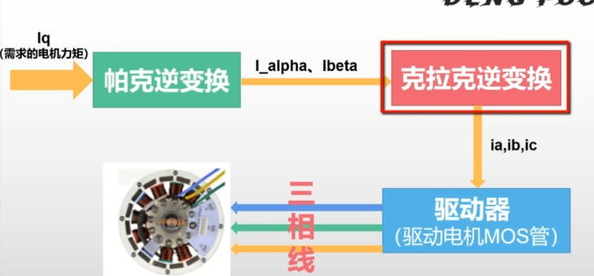
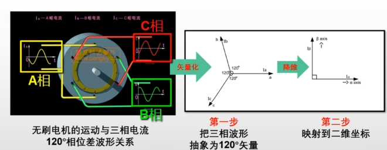
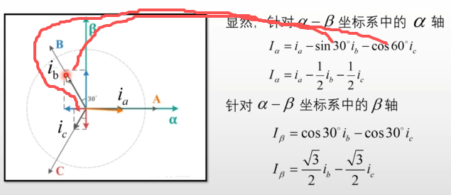
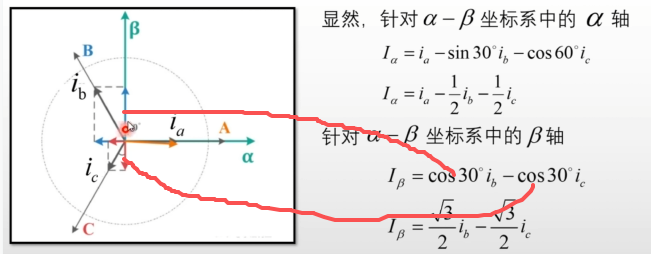
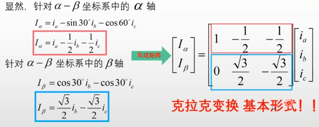
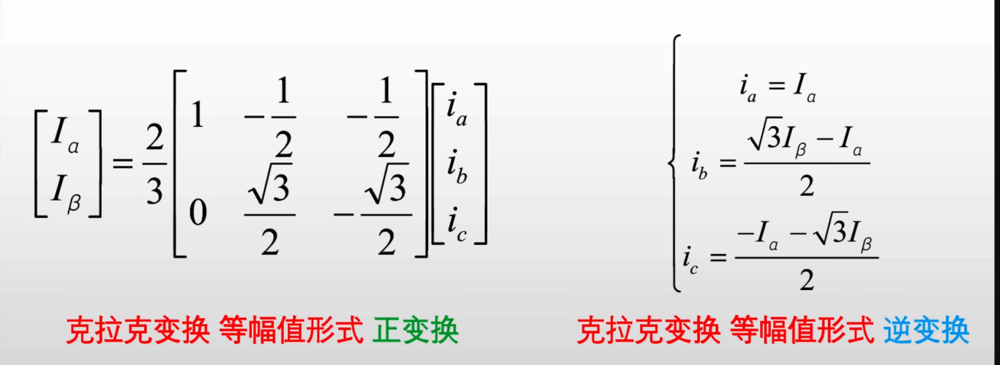

## 克拉克变化(Clark)

通过建立简单的电机数学模型，来简化我们的问题，降维解耦

### 算法流程图
Iq(目标力矩 即电流环/力矩环)
</br>↓</br>
帕克逆变换 -> I_alpha、I_beta
</br>↓</br>
克拉克逆变换 -> ia、ib、ic
</br>↓</br>
驱动器(驱动电机MOS管)
</br>↓ (三相线)</br>
无刷电机</br>



### 克拉克变化-概念
无刷电机的运动 与 三相电流波形
</br>↓ (矢量化)</br>
三项波形 变为 120度矢量
</br>↓ (降维)</br>
映射到二维坐标 (阿尔法α贝塔β坐标系)




### 克拉克变化-推导
三个矢量夹角为120度矢量，我们把三个矢量投影到二维坐标上，得到两个分量:
```python
Iα = ia - (1/2)ib - (1/2)ic
Iβ = (√3 / 2)ib - (√3 / 2)ic

# (Ix为坐标系分量, ix为向量)
```



然后我们把推导的结果写成矩阵的形式
$$\begin{bmatrix}
I_α\\
I_β\\
\end{bmatrix} = \begin{bmatrix}
1&-1/2&-1/2\\
0&√3/2&-√3/2\\
\end{bmatrix} \begin{bmatrix}
i_a\\
i_b\\
i_c\\
\end{bmatrix}$$

展开得到:
$$I_α = i_a - \frac{1}{2}i_b - \frac{1}{2}i_c$$
$$I_β = \frac{\sqrt{3}}{2}i_b - \frac{\sqrt{3}}{2}i_c$$

就得到了克拉克变化的基本形式


### 克拉克变化-等幅值变化
给基本形式乘以2/3，在原来的基础上进一步简化，能够更加直观的处理三相电，使Iα=ia

$$\begin{bmatrix}
I_α\\
I_β\\
\end{bmatrix} = \frac{2}{3}\begin{bmatrix}
1&-1/2&-1/2\\
0&\sqrt{3}/2&-\sqrt{3}/2\\
\end{bmatrix} \begin{bmatrix}
i_a\\
i_b\\
i_c\\
\end{bmatrix}$$

展开得到:
$$I_α = \frac{2}{3}(i_a - \frac{1}{2}i_b - \frac{1}{2}i_c)$$
$$I_β = \frac{2}{3}(\frac{\sqrt{3}}{2}i_b - \frac{\sqrt{3}}{2}i_c)$$

由基尔霍夫电流定律得:
$$i_a + i_b + i_c = 0 \Rightarrow i_c = -(i_a + i_b)$$

带回展开式，消去 $i_c$:
$$I_β = \frac{1}{\sqrt{3}}(2i_b + i_a)$$
$$I_α = ia$$

通过上述推导可得，我们只需要知道两路电流，就可以计算出另外一相的电流</br>
因此在硬件上就可以省去一路电流传感器

### 克拉克变化-克拉克逆变换
整理上述等幅值变化，得到下面的式子:
$$I_α = i_a$$
$$I_β = \frac{1}{\sqrt{3}}(2i_b + i_a)$$

通过代入和基尔霍夫定律分别得到下面的公式:
$$i_a = I_α$$
$$i_b = \frac{\sqrt{3}I_β - I_α}{2}$$
$$i_c = \frac{-I_α - \sqrt{3}I_β}{2}$$

