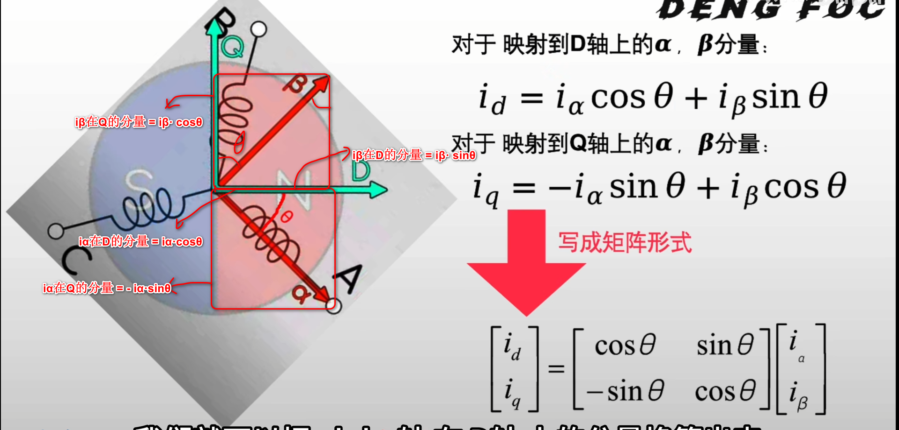
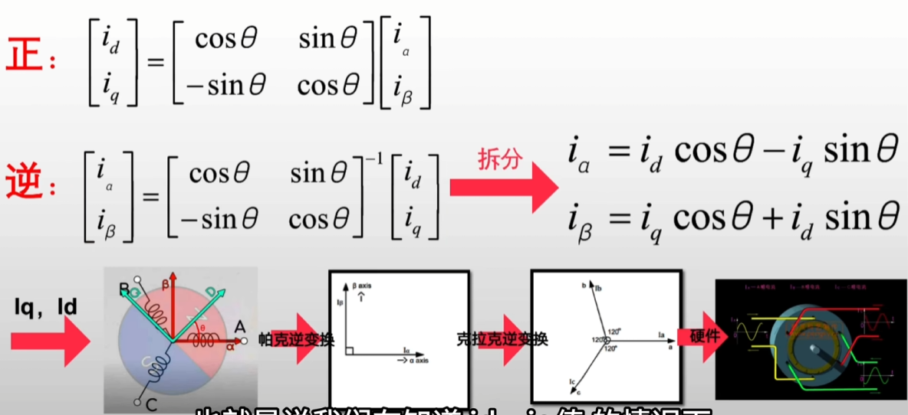

## 帕克变换(Park)

将电机旋转的物理状态转换为I_alpha、I_beta，输入到克拉克变换中

### 帕克变换-概念
在原有的α-β坐标系上，新建一个Q-D坐标系随转子转动，且D指向电机N极 
D与α的夹角**θ**，称为电角度

### 帕克变换-推导
然后我们把α-β坐标系的量投射到Q-D坐标系上
$$i_d = i_\alpha \cos\theta + i_\beta \sin\theta$$
$$i_q = -i_\alpha \sin\theta + i_\beta \cos\theta$$

写成矩阵的形式
$$\begin{bmatrix}
i_d \\ i_q
\end{bmatrix} = \begin{bmatrix}
\cos\theta & \sin\theta \\
-\sin\theta & \cos\theta
\end{bmatrix} \begin{bmatrix}
i_\alpha \\ i_\beta
\end{bmatrix}$$
其中等号后面的前半部分我们称为**旋转矩阵**

### 帕克变换-帕克逆变换
上一步我们得到了帕克变换的矩阵形式
$$\begin{bmatrix}
i_d \\ i_q
\end{bmatrix} = \begin{bmatrix}
\cos\theta & \sin\theta \\
-\sin\theta & \cos\theta
\end{bmatrix} \begin{bmatrix}
i_\alpha \\ i_\beta
\end{bmatrix}$$
帕克变换矩阵是正交矩阵（旋转矩阵），其逆矩阵就是转置
$$\begin{bmatrix}
i_\alpha \\ i_\beta
\end{bmatrix} = \begin{bmatrix}
\cos\theta & -\sin\theta \\
\sin\theta & \cos\theta
\end{bmatrix} \begin{bmatrix}
i_d \\ i_q
\end{bmatrix}$$

展开得到
$$i_\alpha = i_d \cos\theta - i_q \sin\theta$$
$$i_\beta = i_d \sin\theta + i_q \cos\theta$$

其中id、iq是有方向的旋转矢量，θ的值通过编码器实时测量得到

因此变化的值只有θ， id、iq为定值，输入到克拉克逆变换中输出
在实际应用中，我们设置iq的值(Q轴电流)，id的值设置为0；给定一个目标力矩iq后，θ的值变化，同时会计算出新的iα与iβ，使得在新的电角度下也能保持正确的力矩

iq体现为一个旋转的矢量，会间接影响磁场强度

